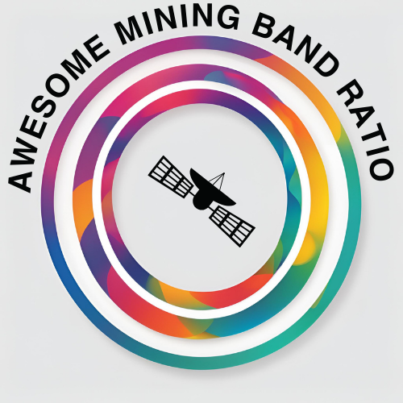

# Awesome Mining Band Ratio

  

A curated list of  materials, mineral spectral signature and published band ratios aiming the application of Remote Sensing to Mineral Exploration. 

**Please contribute. Let's make this guide better!**

**Table of Contents**

- [Aster Band Ratios](#aster-band-ratios)
- [Landsat and Sentinel](#landsat-and-sentinel)
- [Minerals Spectra Signature](#minerals-spectra-signature)
- [Awesome List](#awesome-list)

---

## Aster Band Ratios

**IMPORTANT**: the SWIR sensor (bands 4 to 9) are inoperable since 1st April 2008, and therefore only data acquired before this date will be suitable for mineral mapping

| Feature               | Aster Band Ratio    | Ratio Description                                             | Reference                             |
|-----------------------|---------------------|---------------------------------------------------------------|---------------------------------------|
| Iron Minerals         | B2/B1               | Ferric Fe3                                                    | [Rowan and Mars, 2003](https://www.sciencedirect.com/science/article/pii/S003442570200127X); [Hewson et al., 2001, 2004a](https://ieeexplore.ieee.org/stamp/stamp.jsp?tp=&arnumber=976615); [Rockwell, 2012, USGS SIM 3190](https://pubs.usgs.gov/sim/3190/contents/SIM3190_pam.pdf) (p. 7) |
| Iron Minerals         | (B5/B3)+(B1/B2)     | Ferrous Fe2                                                   | [Rowan and Mars, 2003](https://www.sciencedirect.com/science/article/pii/S003442570200127X)                |
| Iron Minerals         | B4/B2               | Gossan                                                        | [Volesky et al., 2003](https://www.sciencedirect.com/science/article/pii/S0301926803000706)                |
| Iron Minerals         | B5/B4               | Ferrous Silicates (biotite, chl, amphibolite) Cu-Au Alteration | [Hewson et al., 2001, 2004a](https://ieeexplore.ieee.org/stamp/stamp.jsp?tp=&arnumber=976615)         |
| Iron Minerals         | B4/B3               | Ferric Oxides                                                 | [Hewson et al., 2001, 2004a](https://ieeexplore.ieee.org/stamp/stamp.jsp?tp=&arnumber=976615)         |
| Carbonates/Mafic Minerals | (B7+B9)/B8     | Carbonate/Chlorite/Epidote                                    | [Rowan and Mars, 2003](https://www.sciencedirect.com/science/article/pii/S003442570200127X)                |
| Carbonates/Mafic Minerals | B13/B14        | Carbonate Index (Exoskarn (cal/dolom) 92% cfd)                 | Bierwirth 2002, Nimoyima         |
| Carbonates/Mafic Minerals | (B6+B9)/(B7+B8) | Epidote/Chlorite/Amphibole (Endoskarn)                        | [Hewson et al., 2001, 2004a](https://ieeexplore.ieee.org/stamp/stamp.jsp?tp=&arnumber=976615); [Rockwell, 2012, USGS SIM 3190](https://pubs.usgs.gov/sim/3190/contents/SIM3190_pam.pdf) (p. 10)                                |
| Carbonates/Mafic Minerals | (B6+B9)/B8     | Amphibole/MgOH (Can be other MgOH or carbonate*)             | [Hewson et al., 2001, 2004a](https://ieeexplore.ieee.org/stamp/stamp.jsp?tp=&arnumber=976615)         |
| Carbonates/Mafic Minerals | B6/B8          | Amphibole                                                      | [Bierwirth, 2002](https://pubs.geoscienceworld.org/segweb/economicgeology/article-abstract/97/4/819/22214/Hyperspectral-Mapping-of-Mineral-Assemblages)                          |
| Carbonates/Mafic Minerals | (B6+B8)/B7     | Dolomite                                                       | [Rowan and Mars, 2003](https://www.sciencedirect.com/science/article/pii/S003442570200127X)                |
| Carbonates/Mafic Minerals | (B7/B6)*(B4/B6) | Hydroxyl Group (OHI) 92% cfd                                  | [Ninomiya, 2002](https://www.researchgate.net/publication/234942606_Mapping_quartz_carbonate_minerals_and_mafic-ultramafic_rocks_using_remotely_sensed_multispectral_thermal_infrared_ASTER_data)                     |
| Carbonates/Mafic Minerals | (B4/B5)*(B8/B6) | Kaolinite (KLI) 92% cfd                                       | [Ninomiya, 2002](https://www.researchgate.net/publication/234942606_Mapping_quartz_carbonate_minerals_and_mafic-ultramafic_rocks_using_remotely_sensed_multispectral_thermal_infrared_ASTER_data)                     |
| Carbonates/Mafic Minerals | (B7/B5)*(B7/B8) | Alunite (ALI) 92% cfd                                         | [Ninomiya, 2002](https://www.researchgate.net/publication/234942606_Mapping_quartz_carbonate_minerals_and_mafic-ultramafic_rocks_using_remotely_sensed_multispectral_thermal_infrared_ASTER_data)                     |
| Carbonates/Mafic Minerals | (B6/B8)*(B9/B8) | Calcite (CLI)                                                  | [Ninomiya, 2002](https://www.researchgate.net/publication/234942606_Mapping_quartz_carbonate_minerals_and_mafic-ultramafic_rocks_using_remotely_sensed_multispectral_thermal_infrared_ASTER_data)                     |
| Silicates             | (B5+B7)/B6          | Sericite / Muscovite / Illite / Smectite (Phyllic alteration) | [Rowan and Mars, 2003](https://www.sciencedirect.com/science/article/pii/S003442570200127X); [Hewson et al., 2001, 2004a](https://ieeexplore.ieee.org/stamp/stamp.jsp?tp=&arnumber=976615); [Rockwell, 2012, USGS SIM 3190](https://pubs.usgs.gov/sim/3190/contents/SIM3190_pam.pdf) (p. 9) |
| Silicates             | (B4+B6)/B5          | Alunite / Kaolinite (Pyrophyllite) 92% cfd                   | [Rowan and Mars, 2003](https://www.sciencedirect.com/science/article/pii/S003442570200127X)               |
| Silicates             | B7/B6               | Muscovite 92% cfd                                             | [Hewson et al., 2001, 2004a](https://ieeexplore.ieee.org/stamp/stamp.jsp?tp=&arnumber=976615)         |
| Silicates             | B7/B5               | Kaolinite 92% cfd                                             | [Hewson et al., 2001, 2004a](https://ieeexplore.ieee.org/stamp/stamp.jsp?tp=&arnumber=976615)         |
| Silicates             | (B5*B7)/(B6*B6)     | Clay 92% cfd                                                  | Bierwith, 2002                      |
| Silica Sio2           | B14/B12             | Quartz Rich Rocks Qz Index                                    | [Rowan and Mars, 2003](https://www.sciencedirect.com/science/article/pii/S003442570200127X)               |
| Silica Sio2           | (B11/B10)*(B11/B12) | Quartz 92% cfd                                                | Ninomya, 2003a                      |
| Silica Sio2           | B12/B13             | Silica (Basic Degree Index (gnt))                               | Ninomiya,  2002; [Bierwirth, 2002](https://pubs.geoscienceworld.org/segweb/economicgeology/article-abstract/97/4/819/22214/Hyperspectral-Mapping-of-Mineral-Assemblages);  [Hewson et al., 2001, 2004a](https://ieeexplore.ieee.org/stamp/stamp.jsp?tp=&arnumber=976615)    |
| Silica Sio2           | B13/B10             | Silica                                                         | [Hewson et al., 2001, 2004a](https://ieeexplore.ieee.org/stamp/stamp.jsp?tp=&arnumber=976615)         |
| Silica Sio2           | (B11xB11)(B10B12)  | Silica Index 92% cfd                                          | Ninoyima, 2002                            |

| ▲ [Top](#awesome-mining-band-ratio) |
|---|

## Landsat and Sentinel

Landsat and Sentinel don't have the same range as Aster. The ratios and RBG compositions below can be done with data from them and other plataforms. In order to make it comparable, let's use [Awesome Spectral Indeces](https://awesome-ee-spectral-indices.readthedocs.io/en/latest/index.html) table of generic variables for spectral indices expressions and satellite equivalents.

#### Bands Comparison Among Plataforms

<table>
<tr>
<th> Description </th>
<th> Standard </th>
<th> Spectral Range (nm) </th>
<th> Sentinel-2 </th>
<th> Landsat-89 </th>
<th> Landsat-457 </th>
<th> ASTER (approx.) </th>
</tr>
<tr>
<td>Aerosols</td>
<td>A</td>
<td>400 - 455</td>
<td>B1</td>
<td>B1</td>
<td></td>
<td>—</td>
</tr>
<tr>
<td>Blue</td>
<td>B</td>
<td>450 - 530</td>
<td>B2</td>
<td>B2</td>
<td>B1</td>
<td>—</td>
</tr>
<tr>
<td>Green</td>
<td>G</td>
<td>510 - 600</td>
<td>B3</td>
<td>B3</td>
<td>B2</td>
<td>B1</td>
</tr>
<tr>

<tr>
<td>Red</td>
<td>R</td>
<td>620 - 690</td>
<td>B4</td>
<td>B4</td>
<td>B3</td>
<td>B2</td>
</tr>
<tr>
<td>Red Edge 1</td>
<td>RE1</td>
<td>695 - 715</td>
<td>B5</td>
<td></td>
<td></td>
<td>—</td>
</tr>
<tr>
<td>Red Edge 2</td>
<td>RE2</td>
<td>730 - 750</td>
<td>B6</td>
<td></td>
<td></td>
<td>—</td>
</tr>
<tr>
<td>Red Edge 3</td>
<td>RE3</td>
<td>765 - 795</td>
<td>B7</td>
<td></td>
<td></td>
<td>—</td>
</tr>
<tr>
<td>NIR</td>
<td>N</td>
<td>760 - 900</td>
<td>B8</td>
<td>B5</td>
<td>B4</td>
<td>B3N</td>
</tr>
<tr>
<td>NIR 2</td>
<td>N2</td>
<td>850 - 880</td>
<td>B8A</td>
<td></td>
<td></td>
<td>B3N (approx.)</td>
</tr>
<tr>
<td>Water Vapour</td>
<td>WV</td>
<td>930 - 960</td>
<td>B9</td>
<td></td>
<td></td>
<td>—</td>
</tr>
<tr>
<td>SWIR 1</td>
<td>S1</td>
<td>1550 - 1750</td>
<td>B11</td>
<td>B6</td>
<td>B5</td>
<td>B4</td>
</tr>
<tr>
<td>SWIR 2</td>
<td>S2</td>
<td>2080 - 2350</td>
<td>B12</td>
<td>B7</td>
<td>B7</td>
<td>B5–B9 (partial coverage)</td>
</tr>
<tr>
<td>Thermal</td>
<td>T</td>
<td>10400 - 12500</td>
<td></td>
<td></td>
<td>B6</td>
<td>B13–B14 (partial)</td>
</tr>
<tr>
<td>Thermal 1</td>
<td>T1</td>
<td>10600 - 11190</td>
<td></td>
<td>B10</td>
<td></td>
<td>B13 (approx.)</td>
</tr>
<tr>
<td>Thermal 2</td>
<td>T2</td>
<td>11500 - 12510</td>
<td></td>
<td>B11</td>
<td></td>
<td>B14 (partial)</td>
</tr>
</table>

**ASTER mapping note:** Approximate spectral correspondence only, not interchangeable spectral response functions. ASTER has no dedicated blue, aerosol, or red-edge bands. ASTER SWIR bands B5–B9 sample different portions of the broad SWIR2 range; none is an exact substitute for Sentinel-2 B12 or Landsat B7. ASTER thermal bands B13–B14 only partially overlap Landsat thermal channels. ASTER SWIR data are available only for acquisitions before the April 2008 SWIR failure.

____

#### RGB Composition and Band Ratio for Landsat 8-9 and Sentinel-2 

**Aster Bands 5 to 7 fall within band 12 of Sentinel-2.**

| Description                       | Ratio / Channel R | Channel G | Channel B | Comment                            | Reference |
|-----------------------------------|-------------------|-----------|-----------|------------------------------------|-----------|
| Natural Colour                    | R                 | G         | B         |                                    | |
| Colour Infrared (vegetation)      | N                 | R         | G         |                                    | |
| False Colour (Urban)              | S2                | S1        | R         |                                    | |
| Agriculture                       | S1                | N         | B         |                                    | |
| Vegetation Index                  | (N – R)/(N + R)   |           |           |                                    | |
| Moisture Index                    | (N2 – S1)/(N2 + S1)|          |           |                                    | |
| Geology                           | S2                | R         | B         |                                    | |
| Bathymetric                       | R                 | G         | A         |                                    | |
| Atmospheric Penetration           | S2                | S1        | N2        |                                    | |
| SWIR                              | S2                | N2        | R         |                                    | |
| NDWI                              | (G – N)/(G + N)   |           |           |                                    | |
| SWIR-2                            | B                 | S1        | S2        |                                    | |
| Ferric Iron "Redness"             | R/B               |           |           |                                     | [USGS & Servicio Geológico de Bolivia, 1992, Bulletin 1975](https://pubs.usgs.gov/bul/1975/report.pdf) (Table 7, p. 53) |
| Ferric Iron 2                     | (R/B)*((R+S1)/N)  |           |           |                                    | |
| Ferrous Iron                      | (G+S1)/(R+N)      |           |           | coarse grained ferric iron          | |
| Clay, sulphate, mica, marble      | (S1/S2)/(N/R)     |           |           | Compound formula not verified by Bulletin 1975 | |
| Iron sulphate                     | (B/A)-(N/R)       |           |           |                                    | |
| Ross Smail/Getech                 | S1/R              | R/B       | S2/S1     |                                    | |
| Gad and Kusky 1                   | S1/R              | S2/S1     | S1/B      |                                    | |
| Gad and Kusky 2                   | S2/S1             | S1/N      | R/B       | Serpentinites in dark brown-green   | |
| Zohair et al 2019                 | S1/S2             | S1/N      | R/B       | Serpentinites in dark brown         | |
| Pour                              | R/B               | R/S1      | S1/S2     | Serpentinites in yellow             | |
| Sultan 1986/Gomez 2005            | S1/S2             | S1/B      | S1/N * R/N|                                    | |
| Abrams 1983                       | S1/S2             | N/S1      | R/B       | Ultramafic/Basic-Mafic/Felsic       | |
| Mineral map                       | S2/N              | N/S2      | S1/R      |                                    | |

## Minerals Spectra Signature

- [USGS Mineral Spectral Library](https://crustal.usgs.gov/speclab/QueryAll07a.php)

| ▲ [Top](#awesome-mining-band-ratio) |
|---|

## Planetary Datasets

- [Revised CRISM spectral parameters and summary products based on the currently detected mineral diversity on Mars](https://agupubs.onlinelibrary.wiley.com/doi/full/10.1002/2014JE004627)

| ▲ [Top](#awesome-mining-band-ratio) |
|---|

## Other Awesome List

- [Awesome Spectral Indexes](https://awesome-ee-spectral-indices.readthedocs.io/en/latest/index.html) - Awesome list for spectral indices.
- [Awesome Open Geoscience](https://github.com/softwareunderground/awesome-open-geoscience/tree/main) - Awesome list of free and open geoscientific resources.
- [Awesome-Spatial](https://github.com/RoboDonut/awesome-spatial) –  Awesome list for geospatial, not specific to geoscience but significant overlap.
- [Awesome GIS](https://github.com/sshuair/awesome-gis) - Awesome list related to all things Geographic Information Systems (GIS).
- [Awesome Open Climate Science](https://github.com/pangeo-data/awesome-open-climate-science) – Awesome list for atmospheric, ocean, climate, and hydrologic science.
- [Awesome Coastal](https://github.com/chrisleaman/awesome-coastal) – Awesome list for coastal engineers and scientists.
- [Awesome Earth Artificial Intelligence](https://github.com/ESIPFed/Awesome-Earth-Artificial-Intelligence) –  Awesome list for artificial intelligence use cases in Earth Science maintinaed by ESIP (<a href="https://wiki.esipfed.org/Main_Page">Earth Science Information Partners</a>, which is a earth science informatics community) Machine Learning Cluster.
- [Awesome Historic(al) Maps](https://github.com/stark1tty/Awesome-Historic_al-Maps) - Awesome list of resources, databases and tools related to Historic Maps.

| ▲ [Top](#awesome-mining-band-ratio) |
|---|
